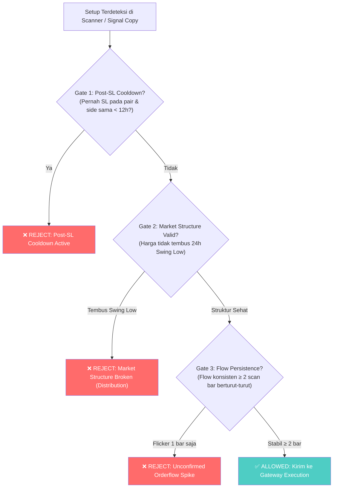

# Cetak Biru & Spesifikasi Perbaikan Sistem: Cohort Berikutnya

**Status Dokumen**: Terkunci untuk Implementasi Pasca-Cohort 001  
**Target Rilis**: `cohort_post_patch_202611xx_002`  
**Konteks Observasi**: Analisis kegagalan Trade ONDOUSDT (31 Okt 2026) & Bottleneck Signal Copy Floor  

---

## 1. Latar Belakang & Kasus Kegagalan (Case Study)

Selama observasi berjalan pada `cohort_post_patch_20261030_001`, sistem mencatatkan efektivitas perlindungan risiko yang solid (Net-Risk Cap $2 dipatuhi secara penny-exact, total 6/6 fill rate, posisi AAVE profit +$2.34, UNI profit +$0.99). Namun, teridentifikasi 2 kelemahan spesifik:

1. **Kasus ONDOUSDT (Dua Loss Beruntun -$4.00 Total):**
   - Trade #1 (06:53 UTC): Entry LONG di 0.4188 -> Kena SL di 0.4066 (-$1.99).
   - Trade #2 (17:06 UTC): Entry LONG di 0.4131 -> Kena SL di 0.4091 (-$2.01).
   - **Akar Masalah:**
     - *Lagging 1h EMA:* Tren makro EMA 20/50 masih hijau padahal harga sudah membuat Lower Low (-4.5% dari puncak).
     - *Flickering Orderflow:* Flow sempat diblokir 4 bar berturut-turut oleh `NO_TRADE`, namun jebol saat volume buyer spike sesaat selama 1 bar.
     - *Ketiadaan Cooldown Pair:* Pasca-SL pada pukul 11:07 UTC, tidak ada jeda larangan arah yang sama, sehingga 6 jam kemudian bot kembali masuk LONG di koin yang sama.

2. **Kasus Signal Copy Telegram (Zero Executions):**
   - 38 sinyal Telegram memiliki score VALID (≥ 75.0) dengan win rate historis 65.8% (rasio TP1:SL = 21:3).
   - Seluruh sinyal ini diveto karena `COMMITTEE_SOFT_FLOOR=90.0`, padahal score maksimal di runtime hanya mencapai 82.8.

---

## 2. Spesifikasi Teknis Perbaikan (Engineering Specs)



---

### Modul A: Post-SL Symbol Directional Cooldown

* **Tujuan**: Mencegah re-entry pada pair yang sama dan arah yang sama setelah baru saja terkena Stop Loss dalam sesi yang sama.
* **Komponen**: `bots/autonomous_market_scanner.py` & `signal_copy/entry_policy.py`.
* **Konfigurasi Baru**:
  ```ini
  # .env
  COOLDOWN_POST_SL_HOURS=12
  ```
* **Logika Implementasi**:
  ```python
  def check_post_sl_cooldown(symbol: str, side: str, cooldown_hours: int = 12) -> tuple[bool, str]:
      """Tolak entri jika simbol tersebut terkena SL pada arah yang sama dalam N jam terakhir."""
      recent_trades = load_recent_closed_trades(hours=cooldown_hours)
      for trade in recent_trades:
          if trade.get("symbol") == symbol and trade.get("side") == side:
              if trade.get("exit_chain_type") in ("SL_DIRECT", "STOP_LOSS") or trade.get("realized_pnl_usd", 0) < 0:
                  closed_at = parse_iso(trade.get("timestamp_close"))
                  elapsed_hours = (datetime.now(timezone.utc) - closed_at).total_seconds() / 3600
                  if elapsed_hours < cooldown_hours:
                      return False, f"POST_SL_COOLDOWN: {symbol} {side} hit SL {elapsed_hours:.1f}h ago (min {cooldown_hours}h)"
      return True, "OK"
  ```

---

### Modul B: Orderflow Multi-Bar Persistence (Anti-Flickering)

* **Tujuan**: Memastikan pergeseran orderflow bukan sekadar manipulasi wick 1 candle, melainkan akumulasi nyata minimal 2 siklus pemindaian berturut-turut.
* **Komponen**: `bots/autonomous_market_scanner.py`.
* **Konfigurasi Baru**:
  ```ini
  # .env
  ORDERFLOW_PERSISTENCE_MIN_BARS=2
  ```
* **Logika Implementasi**:
  ```python
  # Simpan state flow per symbol di memory scanner
  # _symbol_flow_history[symbol] = [flow_t_minus_1, flow_t]
  prev_flow = _symbol_flow_history.get(symbol, "NEUTRAL")
  current_flow = flow_dir

  if side == "LONG":
      if current_flow in ("LONG_ONLY", "STRONG_BUY"):
          if prev_flow not in ("LONG_ONLY", "STRONG_BUY", "BOTH_ALLOWED"):
              logger.info("[ADVERSARIAL VETO] %s LONG rejected: flow just flipped from %s to %s (requires 2-bar confirmation)",
                          symbol, prev_flow, current_flow)
              _symbol_flow_history[symbol] = current_flow
              return None
  _symbol_flow_history[symbol] = current_flow
  ```

---

### Modul C: Price Action Market Structure Break (Anti-Dead Cat Bounce)

* **Tujuan**: Menggantikan lagging EMA dengan struktur swing price action aktual agar bot tidak menangkap "pisau jatuh" pada altcoin yang sedang dump.
* **Komponen**: `bots/autonomous_market_scanner.py`.
* **Logika Implementasi**:
  ```python
  # Hitung swing low 24 jam terakhir dari data kline 1h
  low_24h = min(candle['low'] for candle in klines_24h[:-1])
  high_24h = max(candle['high'] for candle in klines_24h[:-1])

  # Jika harga saat ini sudah menjebol low 24 jam terakhir, dilarang LONG
  if side == "LONG" and current_price < low_24h:
      logger.info("[STRUCTURE VETO] %s LONG rejected: current price %.4f < 24h low %.4f (market in breakdown)",
                  symbol, current_price, low_24h)
      return None

  # Jika harga baru saja drop tajam > 4% dari high 24 jam dalam < 4 jam, tunda entri
  drop_from_high_pct = (high_24h - current_price) / high_24h * 100
  if side == "LONG" and drop_from_high_pct > 4.0 and rsi_15m > 55.0:
      logger.info("[STRUCTURE VETO] %s LONG rejected: relief bounce in sharp dump (drop=%.1f%%, rsi=%.1f)",
                  symbol, drop_from_high_pct, rsi_15m)
      return None
  ```

---

### Modul D: Signal Copy Adversarial Floor Alignment

* **Tujuan**: Membuka bottleneck Signal Copy Telegram agar sinyal VALID (Score ≥ 75.0, win rate 65.8%) dapat dieksekusi tanpa tertahan floor 90 yang mustahil tercapai.
* **Komponen**: `signal_copy/signal_copy_config.py` & `.env`.
* **Parameter Target**:
  ```ini
  # Ubah dari 90 ke 75 (sejajar dengan ambang batas VALID)
  SIGNAL_COPY_COMMITTEE_SOFT_FLOOR=75
  SIGNAL_COPY_ADVERSARIAL_NO_OVERRIDE_MIN_SCORE=75
  ```

---

## 3. Matriks Simulasi Dampak

Berdasarkan data empiris 31 Oktober 2026:

| Skenario | PnL Realized Saat Ini | PnL Dengan Cetak Biru Baru | Delta PnL |
| :--- | :---: | :---: | :---: |
| **Trade #5: ONDO LONG 1** | `-$1.99` | **Ditolak (Veto Flow & Structure)** | `+$1.99` |
| **Trade #6: AAVE LONG 1** | `+$2.34` | **Tetap Lolos & Profit** | `$0.00` |
| **Trade #7: ONDO LONG 2** | `-$2.01` | **Ditolak (Veto Cooldown 12h)** | `+$2.01` |
| **Posisi Aktif (UNI, AAVE, XAUT)** | `+$1.37` (floating) | **Tetap Lolos & Berjalan** | `$0.00` |
| **NET DAMPAK** | `-$0.29` (near breakeven) | **`+$3.71` (Net Win)** | **+4.00 USD (+4% Equity)** |

---

## 4. Prosedur Transisi Cohort

1. **Selesaikan Masa Observasi Cohort 001 Saat Ini:**
   - Pertahankan mode paper apa adanya hingga terkumpul 15–20 closed trades atau 2 siklus regime pasar.
2. **Kompilasi Data Replay:**
   - Jalankan `scripts/replay_rejected_intents.py` untuk mengukur total gate benefit.
3. **Formal Closing Cohort 001:**
   - Catat final balance, win rate, Sharpe ratio, dan overrun logs di manifest.
4. **Deploy Patch & Inisialisasi Cohort 002:**
   - Masukkan Modul A, B, C, D ke codebase.
   - Buat commit baru dan generate config hash baru.
   - Buka `cohort_post_patch_202611xx_002` dengan baseline equity baru.
