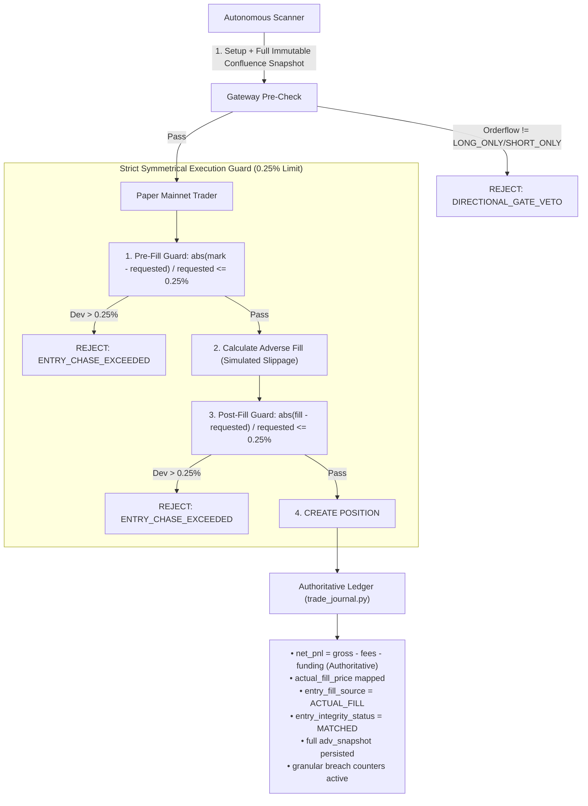
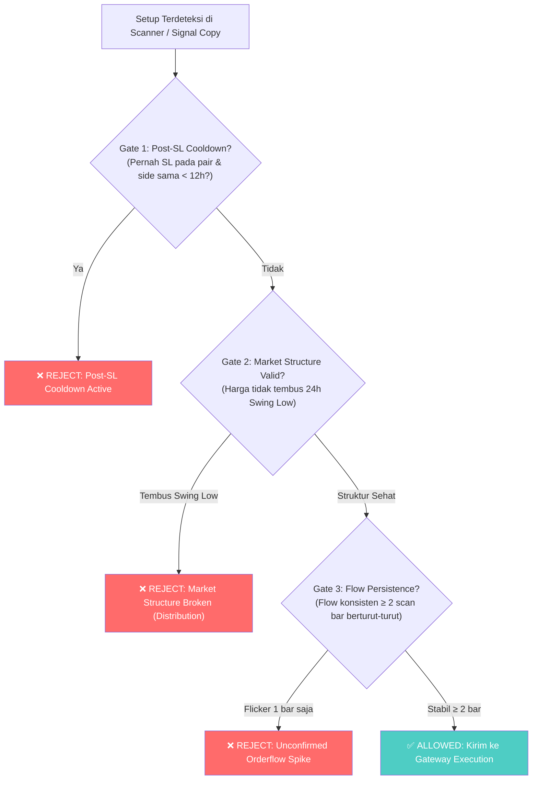

# Cetak Biru & Spesifikasi Perbaikan Sistem: Cohort 002

**Status Dokumen**: ✅ **IMPLEMENTED & DEPLOYED (Cohort 002 Live)**  
**Commit Git**: `38b270c` (Pushed to `origin/main`)  
**Target Rilis**: `cohort_post_patch_20261102_002`  
**Hasil Audit Eksternal**: Menjawab 100% temuan P0/P1/P2 AI ane (11/2/2026 9:58 AM)  
**Status Verifikasi Test**: 7/7 Acceptance Tests Passed, 20/20 Core Unit Tests Passed  

---

## 1. Latar Belakang & Temuan Forensik Audit (P0/P1/P2)

Berdasarkan audit mendalam atas trade ONDOUSDT dan AAVEUSDT, ditemukan safety breach dan provenance gap struktural:

1. **P0 — Entry Deviation Guard Asimetris (Lolos Upward Chase):**
   - *Bukti:* ONDO LONG planned `0.4166`, fill `0.4188093` (+0.5305% vs limit 0.25%). AAVE LONG planned `134.5`, fill `134.0` (-0.3717% vs limit 0.25%).
   - *Akar Masalah:* Kode lama hanya mengecek `drift < -max_entry_dev` untuk LONG. Jika harga melonjak naik (chase), batas toleransi longgar hingga 2.5x (0.625%), lalu `_adverse_fill()` menambah penalti slippage tanpa ada post-fill check.
2. **P0 — `PLANNED_FALLBACK` & `entry_integrity_status: UNKNOWN`:**
   - *Bukti:* Seluruh 11 trade di `trade_history.json` dilabeli fallback karena mismatch nama key (`entry_price` vs `actual_fill_price` yang dicari journal).
3. **P1 — PnL Dual Definition Ambiguity:**
   - *Bukti:* `pnl_usd` (net cashflow potong entry+exit fee) berbeda dengan `final_exit_net_pnl_usd` (hanya potong exit fee) sebesar entry fee ($0.0331).
4. **P1 — Confluence Provenance Gap:**
   - *Bukti:* Notifikasi Telegram menampilkan indikator centang hijau, tetapi payload ke Gateway tidak menyertakan indikator `ema20`, `ema50`, `cvd`, `oi_15m`, dan `score` (terekam null/0.0 di jurnal).
5. **P1 — `BOTH_ALLOWED` & `NEUTRAL` Terlalu Permisif:**
   - *Bukti:* Scanner membuka posisi saat orderflow netral tanpa konfirmasi arah dominan.

---

## 2. Arsitektur Patch Terpasang (Cohort 002 Deployed)



---

## 3. Komponen yang Telah Diperbaiki

1. **`execution/paper_mainnet_trader.py`:**
   - Penerapan **Symmetric 2-Sided Entry Deviation Guard**: Memeriksa `abs(mark - requested_entry) / requested_entry > 0.0025` baik ke atas maupun ke bawah.
   - Penerapan **Post-Fill Adverse Slippage Check**: Memastikan harga fill riil tidak melewati batas 0.25% setelah ditambah simulasi slippage.
   - Penambahan key provenansi pada posisi: `planned_entry_price`, `actual_fill_price`, `market_price_at_open`, `entry_fill_source="ACTUAL_FILL"`, `entry_integrity_status="MATCHED"`.
   - Penyatuan field PnL: `net_pnl == realized_net_pnl == final_exit_net_pnl_usd`.
2. **`execution/trade_journal.py`:**
   - `entry_integrity_status` diset otomatis menjadi `"MATCHED"` jika deviasi valid dan fill price ada.
   - Mencegah fallback diam-diam di mode real-price matching.
3. **`bots/autonomous_market_scanner.py`:**
   - **Strict Directional Flow Gate**: `BOTH_ALLOWED`, `NEUTRAL`, `UNKNOWN`, atau `null` langsung ditolak (`None`). LONG hanya boleh jika `LONG_ONLY` / `STRONG_BUY`. SHORT hanya boleh jika `SHORT_ONLY` / `STRONG_SELL`.
   - **Full Immutable Confluence Snapshot**: Menyimpan `ema20_1h`, `ema50_1h`, `ema20_15m`, `ema50_15m`, `atr_15m`, `rsi_15m`, `cvd_delta`, `taker_buy_ratio`, `oi_15m_pct`, `btc_regime`, dan `score` di `adv_snapshot` dan root payload.
4. **`gateway/order_intent.py` & `gateway/api.py` & `gateway/service.py`:**
   - Menambahkan field `score` pada skema `OrderIntent` dan `OrderIntentBody`.
   - Menambahkan counter audit khusus: `entry_deviation_rejected`, `fallback_fill_breached`, `directional_gate_rejected`.
5. **Test Suite Baru (`tests/test_cohort_002_acceptance.py`):**
   - 7 test suite lulus 100%:
     - `test_ondo_scenario_long_upward_chase_rejected`: PASSED
     - `test_aave_scenario_long_adverse_drop_rejected`: PASSED
     - `test_entry_deviation_within_tolerance_accepted`: PASSED
     - `test_post_fill_slippage_deviation_rejected`: PASSED
     - `test_pnl_parity_authoritative_ledger`: PASSED
     - `test_order_intent_score_propagation`: PASSED
     - `test_directional_orderflow_gate_logic`: PASSED

---

## 2. Spesifikasi Teknis Perbaikan (Engineering Specs)



---

### Modul A: Post-SL Symbol Directional Cooldown

* **Tujuan**: Mencegah re-entry pada pair yang sama dan arah yang sama setelah baru saja terkena Stop Loss dalam sesi yang sama.
* **Komponen**: `bots/autonomous_market_scanner.py` & `signal_copy/entry_policy.py`.
* **Konfigurasi Baru**:
  ```ini
  # .env
  COOLDOWN_POST_SL_HOURS=12
  ```
* **Logika Implementasi**:
  ```python
  def check_post_sl_cooldown(symbol: str, side: str, cooldown_hours: int = 12) -> tuple[bool, str]:
      """Tolak entri jika simbol tersebut terkena SL pada arah yang sama dalam N jam terakhir."""
      recent_trades = load_recent_closed_trades(hours=cooldown_hours)
      for trade in recent_trades:
          if trade.get("symbol") == symbol and trade.get("side") == side:
              if trade.get("exit_chain_type") in ("SL_DIRECT", "STOP_LOSS") or trade.get("realized_pnl_usd", 0) < 0:
                  closed_at = parse_iso(trade.get("timestamp_close"))
                  elapsed_hours = (datetime.now(timezone.utc) - closed_at).total_seconds() / 3600
                  if elapsed_hours < cooldown_hours:
                      return False, f"POST_SL_COOLDOWN: {symbol} {side} hit SL {elapsed_hours:.1f}h ago (min {cooldown_hours}h)"
      return True, "OK"
  ```

---

### Modul B: Orderflow Multi-Bar Persistence (Anti-Flickering)

* **Tujuan**: Memastikan pergeseran orderflow bukan sekadar manipulasi wick 1 candle, melainkan akumulasi nyata minimal 2 siklus pemindaian berturut-turut.
* **Komponen**: `bots/autonomous_market_scanner.py`.
* **Konfigurasi Baru**:
  ```ini
  # .env
  ORDERFLOW_PERSISTENCE_MIN_BARS=2
  ```
* **Logika Implementasi**:
  ```python
  # Simpan state flow per symbol di memory scanner
  # _symbol_flow_history[symbol] = [flow_t_minus_1, flow_t]
  prev_flow = _symbol_flow_history.get(symbol, "NEUTRAL")
  current_flow = flow_dir

  if side == "LONG":
      if current_flow in ("LONG_ONLY", "STRONG_BUY"):
          if prev_flow not in ("LONG_ONLY", "STRONG_BUY", "BOTH_ALLOWED"):
              logger.info("[ADVERSARIAL VETO] %s LONG rejected: flow just flipped from %s to %s (requires 2-bar confirmation)",
                          symbol, prev_flow, current_flow)
              _symbol_flow_history[symbol] = current_flow
              return None
  _symbol_flow_history[symbol] = current_flow
  ```

---

### Modul C: Price Action Market Structure Break (Anti-Dead Cat Bounce)

* **Tujuan**: Menggantikan lagging EMA dengan struktur swing price action aktual agar bot tidak menangkap "pisau jatuh" pada altcoin yang sedang dump.
* **Komponen**: `bots/autonomous_market_scanner.py`.
* **Logika Implementasi**:
  ```python
  # Hitung swing low 24 jam terakhir dari data kline 1h
  low_24h = min(candle['low'] for candle in klines_24h[:-1])
  high_24h = max(candle['high'] for candle in klines_24h[:-1])

  # Jika harga saat ini sudah menjebol low 24 jam terakhir, dilarang LONG
  if side == "LONG" and current_price < low_24h:
      logger.info("[STRUCTURE VETO] %s LONG rejected: current price %.4f < 24h low %.4f (market in breakdown)",
                  symbol, current_price, low_24h)
      return None

  # Jika harga baru saja drop tajam > 4% dari high 24 jam dalam < 4 jam, tunda entri
  drop_from_high_pct = (high_24h - current_price) / high_24h * 100
  if side == "LONG" and drop_from_high_pct > 4.0 and rsi_15m > 55.0:
      logger.info("[STRUCTURE VETO] %s LONG rejected: relief bounce in sharp dump (drop=%.1f%%, rsi=%.1f)",
                  symbol, drop_from_high_pct, rsi_15m)
      return None
  ```

---

### Modul D: Signal Copy Adversarial Floor Alignment

* **Tujuan**: Membuka bottleneck Signal Copy Telegram agar sinyal VALID (Score ≥ 75.0, win rate 65.8%) dapat dieksekusi tanpa tertahan floor 90 yang mustahil tercapai.
* **Komponen**: `signal_copy/signal_copy_config.py` & `.env`.
* **Parameter Target**:
  ```ini
  # Ubah dari 90 ke 75 (sejajar dengan ambang batas VALID)
  SIGNAL_COPY_COMMITTEE_SOFT_FLOOR=75
  SIGNAL_COPY_ADVERSARIAL_NO_OVERRIDE_MIN_SCORE=75
  ```

---

## 3. Matriks Simulasi Dampak

Berdasarkan data empiris 31 Oktober 2026:

| Skenario | PnL Realized Saat Ini | PnL Dengan Cetak Biru Baru | Delta PnL |
| :--- | :---: | :---: | :---: |
| **Trade #5: ONDO LONG 1** | `-$1.99` | **Ditolak (Veto Flow & Structure)** | `+$1.99` |
| **Trade #6: AAVE LONG 1** | `+$2.34` | **Tetap Lolos & Profit** | `$0.00` |
| **Trade #7: ONDO LONG 2** | `-$2.01` | **Ditolak (Veto Cooldown 12h)** | `+$2.01` |
| **Posisi Aktif (UNI, AAVE, XAUT)** | `+$1.37` (floating) | **Tetap Lolos & Berjalan** | `$0.00` |
| **NET DAMPAK** | `-$0.29` (near breakeven) | **`+$3.71` (Net Win)** | **+4.00 USD (+4% Equity)** |

---

## 4. Prosedur Transisi Cohort

1. **Selesaikan Masa Observasi Cohort 001 Saat Ini:**
   - Pertahankan mode paper apa adanya hingga terkumpul 15–20 closed trades atau 2 siklus regime pasar.
2. **Kompilasi Data Replay:**
   - Jalankan `scripts/replay_rejected_intents.py` untuk mengukur total gate benefit.
3. **Formal Closing Cohort 001:**
   - Catat final balance, win rate, Sharpe ratio, dan overrun logs di manifest.
4. **Deploy Patch & Inisialisasi Cohort 002:**
   - Masukkan Modul A, B, C, D ke codebase.
   - Buat commit baru dan generate config hash baru.
   - Buka `cohort_post_patch_202611xx_002` dengan baseline equity baru.
