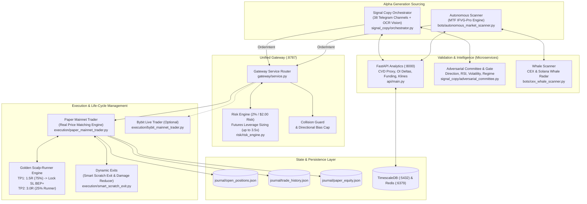
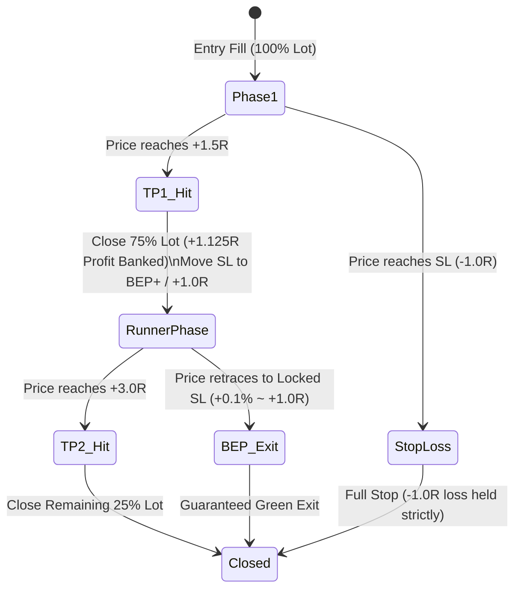

# NEXUS SIGNALCOPY REAL: COMPREHENSIVE ARCHITECTURAL SPECIFICATION & SYSTEM BLUEPRINT

This document provides a complete technical reference for developers and external AI analysis engines. It covers the end-to-end design, execution mechanics, risk governance, mathematical models, and directory structure of the **Nexus SignalCopy Real** algorithmic trading platform.

---

## 1. Executive System Overview

**Nexus SignalCopy Real** is a hybrid autonomous crypto quantitative trading system operating on live Bybit and Binance Perpetual Futures data. It bridges two distinct alpha-generation engines into a single unified execution router:



---

## 2. Directory Structure & File Map

Root Path on Server: `/opt/signalcopyreal`  
GitHub Repository: `https://github.com/jenderalmabuk/scr.git`

```text
/opt/signalcopyreal/
├── api/
│   └── main.py                     # FastAPI REST microservice (klines, orderflow, CVD, OI, funding, BTC regime)
├── bots/
│   ├── autonomous_market_scanner.py # Autonomous MTF IFVG-Pro scanner (systemd daemon: every 180s)
│   ├── cex_whale_scanner.py         # Large CEX whale order monitor (opposing whale veto)
│   └── silent_accumulation_radar.py # Institutional accumulation / distribution detector
├── execution/
│   ├── paper_mainnet_trader.py      # Mainnet-priced paper fill engine & position lifecycle manager
│   ├── bybit_mainnet_trader.py      # Real-money Bybit Futures API execution adapter
│   ├── smart_scratch_exit.py        # Dynamic exit math (time-decay scratch, damage reducer, MFE giveback)
│   └── trade_journal.py             # Atomic ledger writer for trade logs and audit trails
├── gateway/
│   ├── service.py                   # Unified Gateway service (arbitrates notional sizing, leverage, capacity)
│   ├── order_intent.py              # Pydantic schema for universal trade intent abstraction
│   └── run_gateway.py               # Uvicorn entrypoint for Gateway on 127.0.0.1:8787
├── risk/
│   └── risk_engine.py               # Portfolio risk manager (drawdown limits, daily loss, max concurrent)
├── signal_copy/
│   ├── orchestrator.py              # Central event-loop consuming Telegram messages
│   ├── signal_parser.py             # Regex & heuristic text parser extracting symbols, entry, SL, TP ladder
│   ├── vision.py                    # LLM OCR vision engine parsing chart screenshots
│   ├── adversarial_committee.py     # Multi-factor adversarial validator (scores 0-100, assigns conviction)
│   └── btc_regime_gate.py           # Macro Bitcoin correlation & regime direction gate
├── journal/
│   ├── open_positions.json          # Active position state (in-flight SL, dynamic stops, TP hits)
│   ├── trade_history.json           # Permanent record of all completed closed trades
│   ├── paper_equity.json            # High-watermark equity, daily start balance, and current balance
│   └── scratch_exit_audit.jsonl     # Telemetry for all dynamic scratch/damage evaluations
└── docker-compose.full.yml          # Container orchestration (Gateway, FastApi, Collectors, DB, Redis)
```

---

## 3. Alpha Sourcing Engines

### Engine A: Autonomous MTF IFVG-Pro (`bots/autonomous_market_scanner.py`)
Runs as a systemd service (`nexus-autonomous-scanner.service`) every 180 seconds across 32 liquid crypto perpetual pairs:
1. **Filter 1 (TradFi & Illiquid Blacklist)**: Eliminates 16 illiquid tokens (e.g. `EPIC`, `CAP`, `BAT`) and 30 TradFi stock tokens (`AAPL`, `MSFT`, `QQQ`).
2. **Filter 2 (Macro Trend Alignment)**: Checks 1h timeframe:
   - Bullish: $\text{EMA}_{20} > \text{EMA}_{50}$ and $\text{Price} > \text{EMA}_{50}$.
   - Bearish: $\text{EMA}_{20} < \text{EMA}_{50}$ and $\text{Price} < \text{EMA}_{50}$.
3. **Filter 3 (Trigger - Inversion Fair Value Gap)**: Detects 15m FVGs formed within the last 35 candles:
   - $\text{Gap Size} \ge 0.50 \times \text{ATR}_{15\text{m}}$ (Sweet Spot Parameter).
   - Inversion confirmed when candle body closes across the FVG boundary.
4. **Filter 4 (Anti-Wick Noise Floor)**:
   - Stop Loss is placed behind the recent 6-candle swing high/low with a **hard minimum distance of $\ge 1.0\%$** (up to 3.5%).
5. **Filter 5 (Adversarial Veto)**:
   - Rejects if opposing whale order $\ge \$500,000$ occurred within 15 minutes.
   - Rejects if Open Interest (OI) dropped $> -1.5\%$ in 15m.
   - **Order Flow Confirmation**: Vetoes if `flow_dir in ("NO_TRADE", "CONFLICT")`.

### Engine B: Telegram Signal Copy (`signal_copy/orchestrator.py`)
Monitors 38 VIP Telegram channels via Telethon:
1. Text parser (`signal_parser.py`) and Chart OCR (`vision.py`) parse entries, multiple TP targets, and stop-loss.
2. Evaluated by the **Adversarial Committee** (`adversarial_committee.py`):
   - Computes technical score (0–100) combining RSI, MTF alignment, funding rates, CVD, and channel historical winrate.
   - Signals scoring $< 55$ are rejected (`REJECTED_WEAK`).
   - Sizing conviction scale: 0.5x (score 55–64), 1.0x (score 65–79), 1.5x (score $\ge 80$).

---

## 4. Execution & Portfolio Management: The Golden Scalp-Runner

Both engines feed raw `OrderIntent` objects into the **Unified Gateway** (`gateway/service.py`), which standardizes execution:

### 1. Risk-Based Position Sizing (Fixed Risk Target)
- Account target risk is set to **$2.00 USD per trade** (approx 2% of initial $100 capital).
- Position Notional calculation:
$$\text{Notional USD} = \frac{\text{Target Risk USD}}{\text{Stop Loss Distance Fraction}}$$
$$\text{Example: } \text{SL Distance} = 1.2\% \implies \text{Notional} = \frac{\$2.00}{0.012} = \$166.67 \text{ USD}$$
- Sizing is clamped by **Futures Leverage Cap**: Max 3.5x equity (Max notional $350.00 USD). This prevents excessive exposure on micro-SLs.

### 2. Golden Scalp-Runner Ladder (Model 2)


1. **Target 1 (TP1 at 1.5R - 75% Size)**:
   - Closes **75% of the position** to bank cash profit immediately.
   - Automatically mutates active Stop Loss to **Breakeven (BEP + 0.1% fee buffer)** or up to **+1.0R locked profit**.
   - Ensures that the trade can never become a net loser.
2. **Target 2 (TP2 at 3.0R - 25% Runner)**:
   - The remaining 25% runs risk-free to capture high-timeframe continuation.
   - If price retraces, it triggers `BREAKEVEN_EXIT` with positive net realized profit.

---

## 5. Defensive Risk Governance & Circuit Breakers

To prevent portfolio drawdowns during choppy markets and whipsaws, five defensive layers are active:

| Layer | Mechanism | File Location | Purpose |
| :--- | :--- | :--- | :--- |
| **1. Order Flow Veto** | Rejects setups if `flow_dir in ("NO_TRADE", "CONFLICT")` | [`bots/autonomous_market_scanner.py`](file:///opt/signalcopyreal/bots/autonomous_market_scanner.py#L420) | Blocks low-conviction/conflicting CVD and OI breakouts. |
| **2. Directional Cap** | Max 3 correlated altcoins in the same direction (`AUTONOMOUS_MAX_SAME_SIDE=3`) | [`bots/autonomous_market_scanner.py`](file:///opt/signalcopyreal/bots/autonomous_market_scanner.py#L590) | Prevents holding 7–10 SHORTs simultaneously that get wiped on a BTC bounce. |
| **3. Loss Streak Breaker** | 2 consecutive SLs within 90 mins $\implies$ **120-min Cooldown** | [`bots/autonomous_market_scanner.py`](file:///opt/signalcopyreal/bots/autonomous_market_scanner.py#L226) | Protects capital during market maker liquidity hunts and sideways whipsaws. |
| **4. Smart Scratch Exit** | Closes stagnant trades near BEP after timeout (90–270m) | [`execution/smart_scratch_exit.py`](file:///opt/signalcopyreal/execution/smart_scratch_exit.py) | Frees up margin from "zombie trades", avoiding full -1.0R stop-outs. |
| **5. Damage Reducer** | Trims 50% lot if 3 adverse reversal signals confirm at $-0.6\text{R}$ | [`execution/paper_mainnet_trader.py`](file:///opt/signalcopyreal/execution/paper_mainnet_trader.py#L1405) | Cuts losses before reaching hard stop loss. |

---

## 6. Real-Time Telemetry & Database Architecture

- **FastAPI Core (`http://127.0.0.1:8000`)**:
  - `/klines/{exchange}/{symbol}?tf=15m&limit=60`: Microsecond cached OHLCV candles.
  - `/flow/{symbol}`: Returns Cumulative Volume Delta (`cvd_zscore`), taker buy volume, OI change, and `flow_direction`.
  - `/btc_regime`: Computes macro trend, returns `mode: "RISK_OFF" | "NEUTRAL" | "BULLISH"`.
- **Gateway Core (`http://127.0.0.1:8787`)**:
  - `GET /gateway/portfolio`: Real-time JSON snapshot containing equity, open positions, active stop losses, and free risk budget.
  - `POST /gateway/execute`: Receives structured `OrderIntent` payloads.
- **Persistence State**:
  - `journal/open_positions.json`: Active positions synchronized on every 3.0s ticker tick.
  - `journal/trade_history.json`: Array of full trade records including entry/exit timestamps, fees, slippage, gross/net PnL, and normalized reasons.

---

## 7. Key Areas for AI Deep-Dive & Optimization

When analyzing this codebase, external AI systems should focus on the following evaluation questions:

1. **IFVG Sweet Spot Parameter Sensitivity**:
   - Current trigger requires `min_gap >= 0.50 * ATR_15m`. Would a dynamic ATR multiplier based on 1h ADX (e.g., 0.75x in ranging markets, 0.40x in trending markets) reduce false breakouts?
2. **Dynamic Exit Timeout Optimization**:
   - In `execution/smart_scratch_exit.py`, examine whether the `effective_scratch_timeout_min` (currently 90–270m) should scale with market volatility (historical ATR ratio).
3. **Macro BTC Beta Decoupling**:
   - Review `btc_context_snapshot` in `trade_history.json`. Gold pairs (`XAUTUSDT`, `PAXGUSDT`) exhibit near-zero correlation to Bitcoin beta. Should gold/metals have dedicated position limits separate from the crypto universe?
4. **Execution Slippage on Fast-Moving Liquidity**:
   - Evaluate `_paper_fill_entry` in `gateway/service.py` to assess whether simulated slippage accurately reflects Bybit live orderbook depth.
